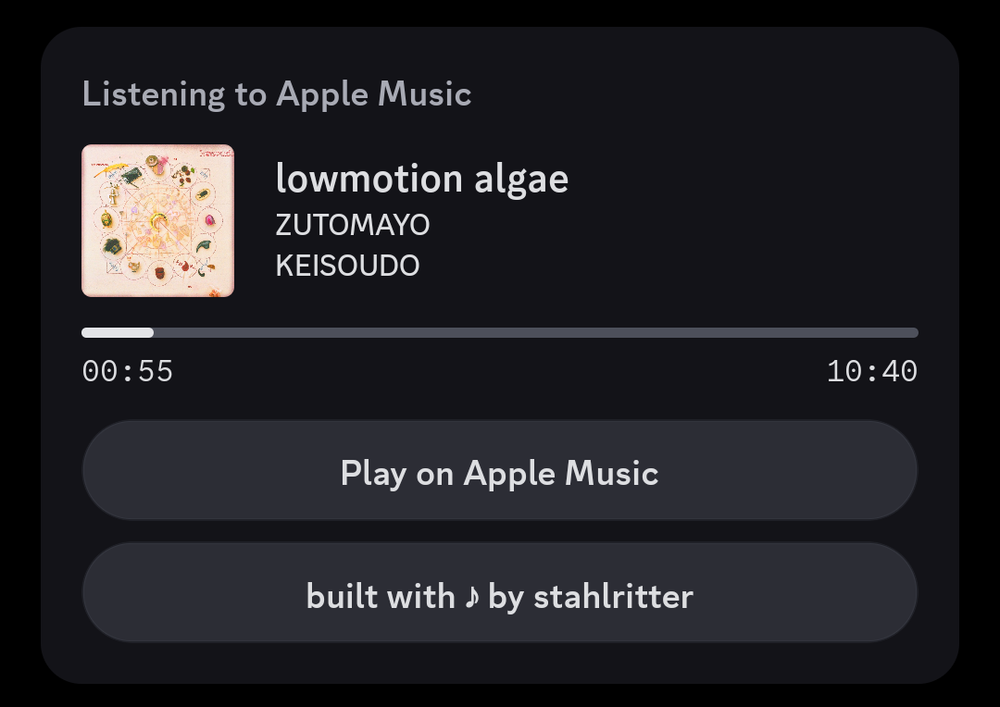
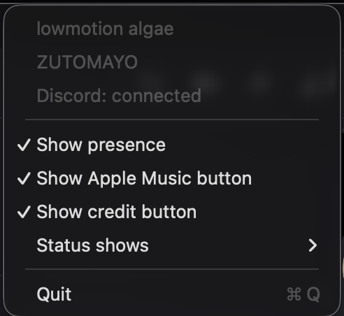

# Apple Music Presence

A tiny macOS menu bar app that shows what you're playing in **Apple Music** as a **Discord Rich Presence** — clean, with just the album cover and **no Apple Music badge** on top of it.

  

## Features

- **Clean album cover** — large image only, no small app badge in the corner
- **Live progress bar** — start/end timestamps follow your playback, including seeking
- **Choose what your status shows** (the short text under your name):
  - **Track** — `Listening to アンドロイドガール`
  - **Artist** — `Listening to DECO*27`
  - **App name** — `Listening to Apple Music`
- **"Play on Apple Music" button** — opens the current song for anyone viewing your profile
- **Clears automatically** when music is paused or stopped
- **Lightweight** — checks Music every 2 seconds and only talks to Discord when something actually changes
- Lives in the menu bar, no Dock icon

## Requirements

- macOS 26.6 or later
- Xcode (to build)
- The Discord **desktop app** running (Rich Presence doesn't work from Discord in a browser)
- The Apple **Music** app

## Download

1. Grab **Apple Music Presence.zip** from the [latest release](https://github.com/mfhanif14/apple-music-presence/releases/latest).
2. Unzip it and move **Apple Music Presence.app** to your **Applications** folder.
3. Open it. Because the app isn't notarized by Apple, macOS will block it the first time:
   - Go to **System Settings → Privacy & Security**, scroll down and click **Open Anyway** next to "Apple Music Presence".
   - Or in Terminal: `xattr -dr com.apple.quarantine "/Applications/Apple Music Presence.app"`
4. Look for the ♪ icon in the menu bar, play something in Music, and click **Allow** when asked to control Music.

> Tip: add it to **System Settings → General → Login Items** so it starts automatically.

## Build & run

1. Clone the repo and open `Untitled Project.xcodeproj` in Xcode.
2. *(Optional)* Use your own Discord application:
   1. Go to the [Discord Developer Portal](https://discord.com/developers/applications) → **New Application**.
      The application name is what appears as "Listening to **…**".
   2. Copy the **Application ID** and paste it into `clientID` in `PresenceController.swift`.
3. Press **⌘R**.
4. Play something in Music. The first time, macOS asks for permission to control **Music** — click **Allow**.

> App Sandbox is turned off on purpose: the app needs it off to reach Discord's local IPC socket and to read the current track from Music.

## Menu options

Click the ♪ icon in the menu bar:

  

| Option | What it does |
|---|---|
| Show presence | Turn the whole Rich Presence on/off |
| Show Apple Music button | Toggle the "Play on Apple Music" button |
| Show credit button | Toggle the "built with ♪" button |
| Status shows | Track / Artist / App name |
| Quit | Quits the app (Discord clears the presence) |

## How it works

| File | Role |
|---|---|
| `MusicReader.swift` | Reads title, artist, album, duration and position from Music via AppleScript |
| `ArtworkFinder.swift` | Looks up the album cover and song link with the public iTunes Search API (Discord needs an image URL, not a file) |
| `DiscordIPC.swift` | Minimal Discord RPC client over the local socket `$TMPDIR/discord-ipc-N` |
| `PresenceController.swift` | Ties it together: builds the "Listening" activity and decides when to update |
| `ContentView.swift` / `MyApp.swift` | Menu bar UI |

## Notes

- **Buttons are only visible to other people.** Discord doesn't show them on your own profile — check from another account.
- The "Play on Apple Music" button only appears when the song is found on the iTunes Store with a matching title, so it never links to the wrong song.
- Local files or songs that aren't on Apple Music may show without a cover.
- Discord's own Spotify-style card (with the service logo on the button) is a first-party integration, so third-party apps can't replicate it — this app keeps it text-only.
